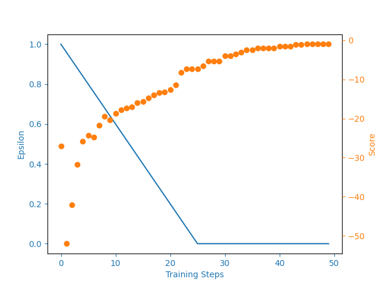

# q-learning-link-balancer

Prototype of a reinforcement learning agent that decides where to move traffic when internet exit links are saturated. I wrote it in 2021 for my master's thesis in data science at ESPOL (Ecuador). The thesis was about the automatic movement of public IP blocks between the international exits of an internet service provider, based on NetFlow traffic data.

This repository holds only the learning model, trained on a small simulated environment. The production monitor and the network executor are not included.

## Model

The agent uses tabular Q-learning with an on-policy (SARSA-style) update: the target uses the next action that the epsilon-greedy policy selects.

| Element | Definition |
| --- | --- |
| State | The number of saturated links. |
| Action | The link that receives traffic from the saturated link with the highest capacity. |
| Terminal state | No saturated links. |
| Reward | -1 for each step that does not end the episode. -1 more when the destination link is in another city. -10 for an impossible move to a saturated link. |
| Saturation | 95% of capacity for links with a capacity of 100 or more, 90% for smaller links. |
| Moved traffic | A reference block that depends on the capacity of the saturated link. |

Training runs 50 epochs. Epsilon goes from 1 (random) to 0 (greedy), and the discount factor is 1, so future rewards count as much as the current reward. The penalties teach the agent to fix saturation in few moves and to prefer links in the same city.



`examples/grid_world.py` is the grid world exercise that I used to validate the update rule before I modeled the network.

## Usage

```bash
pip install -r requirements.txt
python main.py
```

`main.py` trains the agent, saves the Q table to `files/q_table.pickle` and plots the learning curve. Set `LEARN = False` to load the saved table and choose an action for the example links.
